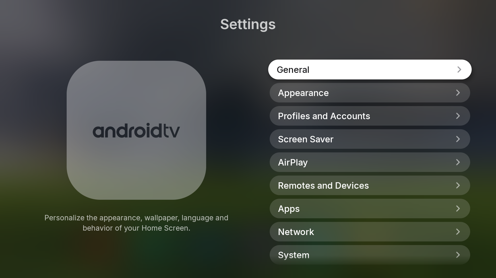

# tvOS Launcher for Android TV

  **A Premium APtvOS-Inspired Experience**

  A modern and elegant Android TV launcher focused on personalization, immersive visuals, and a refined big-screen experience.

  

---

## ✨ About

**tvOS Launcher** transforms the traditional Android TV home screen into a more personal and visually immersive experience, inspired by the design philosophy of **APtvOS**.

Combining elegant aesthetics with distinctive features, it brings a fresh approach to how users customize and interact with their television.

## 🚀 Special Features

- **Multi-Source Custom Images:** Personalize the home screen using images from multiple supported sources.
- **Duo Clock:** A distinctive dual-clock experience for displaying time in a stylish way.
- **Real-Time Weather Effects:** Dynamic weather information and atmospheric visual effects.
- **Built-in AirPlay Support:** Turn your Android TV into an AirPlay receiver with an additional companion app.
- **Advanced Appearance Customization:** Personalize wallpapers, backgrounds, and visual presentation.
- **APtvOS-Inspired Settings:** A dedicated settings interface with a clean and cohesive design.

  

---

## 🎯 Our Vision

To bring together the visual elegance of APtvOS-inspired design and the flexibility of Android TV, creating a more personal, beautiful, and immersive television experience.

## 📦 Updates & Releases

This repository provides official APK downloads, release notes, and update information.

Visit **[Releases](https://github.com/zikkunmusic/tvOS-Launcher-for-Android-TV/releases)** to get the latest version of tvOS Launcher.

## 🤖 Development Acknowledgements

Developed independently with assistance from **ChatGPT by OpenAI** in software architecture, coding, debugging, UI/UX concepts, and documentation.

Project direction, decisions, testing, and final integration are managed by the project maintainer.

## 🤝 Feedback & Contributions

Bug reports, suggestions, and feature requests are welcome. Feel free to open an issue to help improve the project.

---

  **tvOS Launcher**

  Make your TV experience uniquely yours.

